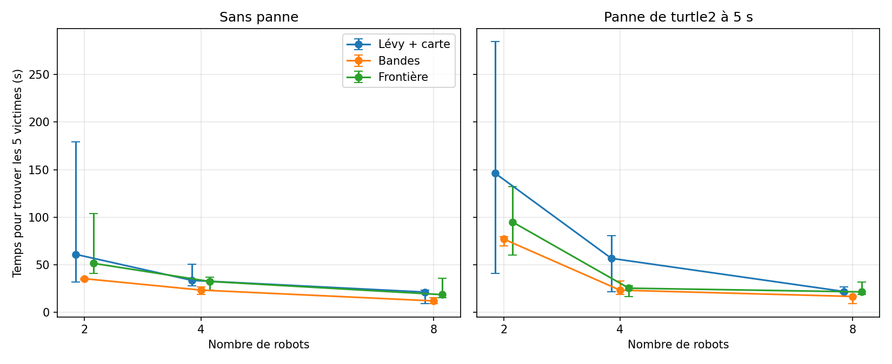

# Essaim de robots pour la recherche et le sauvetage (ROS 2)

Un essaim de robots explore une zone sinistrée pour y retrouver des victimes. Il n'y a **pas de chef** : chaque robot décide seul, à partir de ce qu'il voit et de ce que lui disent ses voisins. L'essaim doit aussi **continuer la mission quand un robot tombe en panne**.

Le projet est développé sous **ROS 2 Jazzy** en Python (`rclpy`). Il est simulé d'abord dans `turtlesim`, puis le sera dans Gazebo, et enfin sur de vrais robots.



## Ce que fait le projet

- **N robots** (de 2 à 8) partent du centre d'une arène de 11 × 11 m.
- **5 victimes** sont placées au hasard (selon une graine reproductible), à plus de 2 m du centre. Un robot détecte une victime à moins de 0,6 m.
- **Une station de base** chronomètre la mission, mesure la couverture de la zone et enregistre chaque mission dans un CSV.
- On peut **simuler une panne** (un robot disparaît à un instant donné) et une **portée radio limitée**.

## Trois stratégies d'exploration

| Stratégie | Principe | Coordination |
|---|---|---|
| `levy` | Marche de Lévy (beaucoup de petits pas, quelques grands sauts), répulsion entre robots, rebond de billard sur les murs | Carte de couverture partagée (grille 11 × 11) : chaque robot évite les cases déjà visitées par les autres |
| `bandes` | La zone est découpée en 10 allées verticales, parcourues en zigzag (boustrophédon) | Partage des allées au départ. **Réparation locale** : si un robot se tait plus d'1 s, ses deux voisins vivants se partagent ses allées restantes. Un robot qui a fini repasse en Lévy |
| `frontiere` | Chaque robot va vers la case non visitée la plus proche **dans sa cellule de Voronoï** (les cases plus proches de lui que des autres robots) | Carte partagée et positions des voisins. Si sa cellule est vide, il va vers la case libre la plus proche |

## Résultats

**90 missions** : 3 stratégies × 2, 4 et 8 robots × avec ou sans panne × 5 graines. Les valeurs sont des **médianes** du temps pour trouver les 5 victimes. Le graphique montre aussi le min et le max.

| Stratégie | 2 robots | 4 robots | 8 robots |
|---|---|---|---|
| Lévy + carte, sans panne | 60,8 s | 33,4 s | 21,1 s |
| Bandes, sans panne | **35,2 s** | **23,2 s** | **11,8 s** |
| Frontière, sans panne | 51,4 s | 32,3 s | 18,4 s |
| Lévy + carte, panne à 5 s | 146,3 s | 56,6 s | 21,7 s |
| Bandes, panne à 5 s | **76,9 s** | **23,1 s** | **16,5 s** |
| Frontière, panne à 5 s | 94,9 s | 25,2 s | 21,3 s |

**Ce que l'on peut conclure :**

- **Les 90 missions ont réussi**, panne comprise. La réparation locale de la stratégie en bandes fonctionne.
- **Les bandes sont les plus rapides et les plus régulières**, avec ou sans panne. Avec 2 robots, leurs temps vont de 33,9 à 35,6 s, contre 31,5 à 179,5 s pour Lévy.
- **Avec 2 robots, une panne laisse un seul robot**, qui doit faire tout le travail. On s'attend donc à un temps environ × 2. Les bandes font × 2,18 : la réparation reprend le travail sans presque rien perdre. Lévy fait × 2,41.
- **La stratégie frontière n'apporte pas le gain attendu** : ses temps sont proches de ceux de Lévy. Une case est marquée « visitée » dès qu'un robot y entre, alors qu'il détecte à 0,6 m. Le robot visite donc les 121 cases une à une, et tourne sur place à chaque fois.
- **Limite statistique** : avec 5 graines par configuration, les écarts de moins de 30 % environ ne sont pas significatifs. Par exemple, Frontière à 4 robots semble plus rapide *avec* une panne (× 0,78), ce qui relève du hasard.

Une expérience précédente (5 graines, stratégie Lévy) montre que la carte partagée réduit le temps moyen de 13 à 32 % par rapport à des robots qui ne partagent rien. Les plages min-max se chevauchent toutefois beaucoup (`temps_vs_robots.png`).

## Lancer le projet

Prérequis : Ubuntu 24.04 (ou WSL2), ROS 2 Jazzy et `turtlesim`.

```bash
cd ~/ros2_ws && colcon build --symlink-install && source install/setup.bash
```

Une mission avec 4 robots, en stratégie bandes :

```bash
ros2 launch essaim_sar sar.launch.py n:=4 strategie:=bandes
```

| Argument | Défaut | Rôle |
|---|---|---|
| `n` | `4` | Nombre de robots |
| `strategie` | `levy` | `levy`, `bandes` ou `frontiere` |
| `graine` | `42` | Position des victimes (reproductible) |
| `partage` | `true` | Carte de couverture partagée ou non |
| `panne` | `aucune` | Nom du robot qui tombe en panne, par exemple `turtle2` |
| `t_panne` | `20` | Instant de la panne, en secondes après le départ |
| `portee` | `0` | Portée radio en mètres (`0` = illimitée) |

Une panne de `turtle2` après 5 s :

```bash
ros2 launch essaim_sar sar.launch.py n:=4 strategie:=bandes panne:=turtle2 t_panne:=5
```

Reproduire la comparaison (90 missions, environ 1 h 30), puis l'analyser :

```bash
bash experience_strategies.sh && python3 analyse_strategies.py
```

## Architecture

```
src/
├── essaim_sar/
│   ├── essaim_sar/explorateur.py  # un nœud par robot (dans son namespace) : les 3 stratégies
│   ├── essaim_sar/victimes.py     # place les victimes et détecte quand un robot les trouve
│   ├── essaim_sar/base.py         # chronomètre, couverture, écriture du CSV
│   └── launch/sar.launch.py       # crée les robots, les couleurs, la panne
└── mes_interfaces/msg/
    ├── Victime.msg                # id, x, y, trouvee_par
    └── CaseVisitee.msg            # robot, x, y, index de la case
```

| Topic | Type | Rôle |
|---|---|---|
| `/turtleN/pose` | `turtlesim/Pose` | Position de chaque robot, qui sert aussi de battement de cœur pour détecter les pannes |
| `/cases_visitees` | `mes_interfaces/CaseVisitee` | Carte de couverture partagée |
| `/victimes_trouvees` | `mes_interfaces/Victime` | Victimes découvertes |
| `/allees_finies` | `std_msgs/Int32` | Allées terminées (stratégie bandes) |

**Notions mises en œuvre** : namespaces et topics relatifs, paramètres, messages personnalisés, launch dynamique (`OpaqueFunction`, `TimerAction`, `Shutdown`), comportement émergent sans chef, stigmergie (communication par une carte partagée), détection de panne par silence, réparation locale, partition de Voronoï, protocole expérimental reproductible (graines, médianes, min/max).

## Limites connues

- En mode `bandes`, la coordination ignore la portée radio : tous les robots s'entendent.
- La grille de couverture (cases de 1 m) est grossière par rapport au rayon de détection (0,6 m).
- `turtlesim` ne simule ni obstacles, ni capteurs, ni dynamique réelle.

## Suite du projet

1. **Gazebo** : robots à roues décrits en URDF, lidar, obstacles, carte d'occupation, et communication par commérage (gossip) avec une vraie portée.
2. **Robots réels** : petits robots ESP32 avec micro-ROS, localisés par une caméra au plafond et des marqueurs ArUco.

## Autres paquets du dépôt

- `mon_robot` : exercices d'apprentissage de ROS 2 (publisher, subscriber, service, client, essaim de tortues avec comportements de Boids).
- `mes_interfaces` : messages et services personnalisés.
